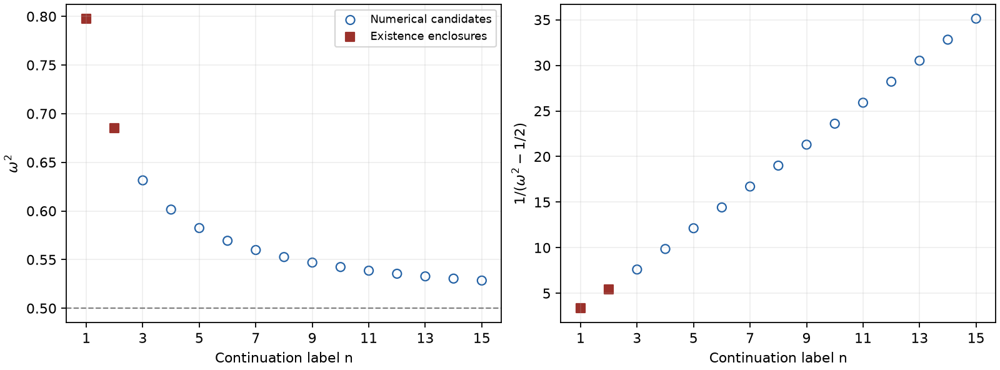
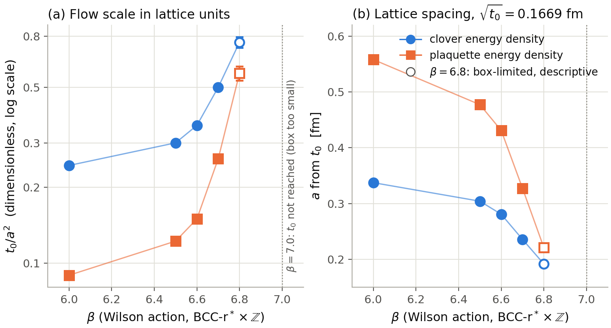
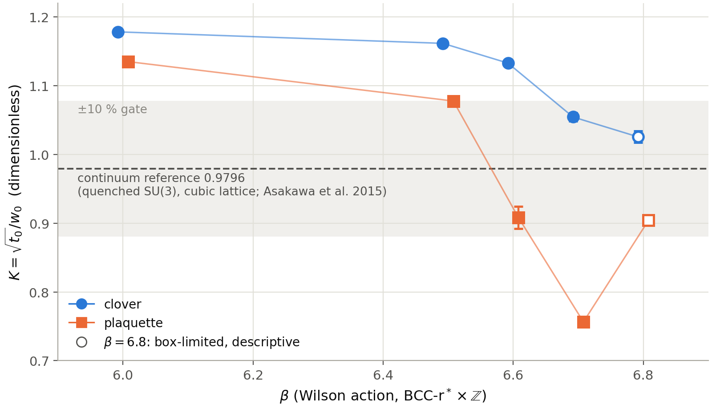
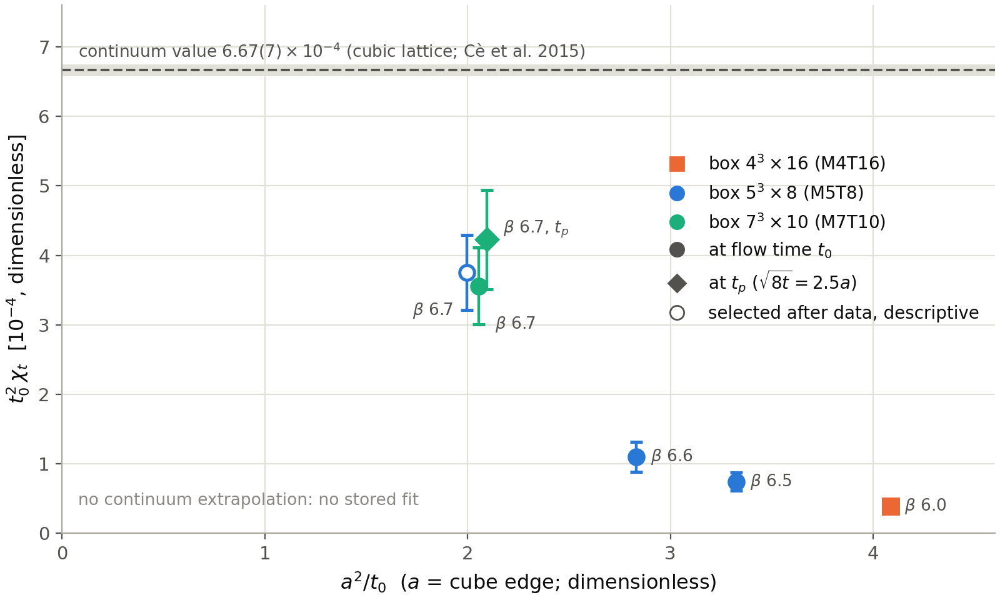
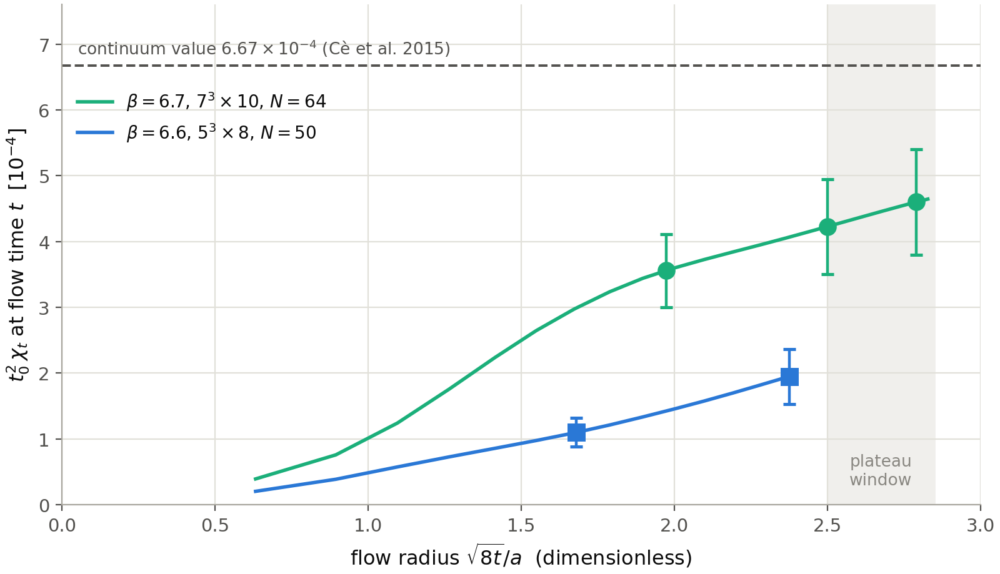

# Stand und nächste Schritte

Stand: 29. Oktober 2026 (Nachtrag); der Abschnitt vom 21. Oktober 2026 folgt unverändert.

## Nachtrag 29.10.2026 (synthetisch, nicht begutachtet)

Zwei Neuerungen seit dem Stand vom 21.10.2026: der Q-Ball-Preprint 0.51 ist veröffentlicht, und der Rechenschwerpunkt
liegt seit dem Abend des 28.10. auf dem Gluonsektor. Die subjektiven Reife-Prozentwerte älterer Übersichten werden
dadurch nicht angehoben. Die internen
Ergebnisdateien zum Gluonsektor sind hier nicht mit veröffentlicht; Abbildungen und geplottete Werte stehen in
[assets/stand-20261029/](assets/stand-20261029/README.md).

### Q-Ball-Preprint 0.51

*Radiative cancellations and localized linear modes in three-dimensional sextic Q-balls* (Finn Hinrichsen, Fassung 0.51):
TeX-Quellen, PDF und HTML in [model-lab/papers/qball-bic-ladder-v0.51/](model-lab/papers/qball-bic-ladder-v0.51/README.md),
Release [qball-bic-v0.51](https://github.com/fmhc/physics/releases/tag/qball-bic-v0.51) mit PDF, Supplement und
Begleitarchiv (ZIP, 37 MB). Kein Bezug zum Tetraedernetz; ein Kontinuumsmodell.
Aktuelle Fassung ist der Preprint 0.52 vom selben Tag (Release
[qball-bic-v0.52](https://github.com/fmhc/physics/releases/tag/qball-bic-v0.52), Quellen in
[model-lab/papers/qball-bic-ladder-v0.52/](model-lab/papers/qball-bic-ladder-v0.52/README.md)): Widmung,
allgemeinverständlicher Überblick (Abschnitt 1) und Übersichtsabbildung (Abb. 1) kommen hinzu; Ergebnisse, Zahlen und
Beweise sind unverändert, das Begleitarchiv bleibt das von 0.51.

- **Computergestützt eingeschlossen:** drei lokalisierte lineare Moden (zwei radial, C0 und C1; ein Dipol, C2) auf dem
  unendlichen radialen Gebiet, mit Intervallarithmetik innen und analytischer Abschätzung außen. Vertrauensannahmen:
  korrekter Beweiscode und korrekte Ball-Arithmetik-Bibliothek. Für 0.51 wurden die drei Zertifikatsläufe mit
  unverändertem Code wiederholt (bytegleiche Schrittprotokolle); das ist eine Reproduktion derselben Implementierung,
  keine unabhängige.
- **Nur numerisch:** weitere Leiterkandidaten bis Index 18 und ein ungefitteter Abstandskandidat aus der Planarwand.
  Ein Test der absoluten Lage in endlicher Ordnung ist gescheitert und steht im Paper.
- **Bedingt:** Eine Analyse zweiter Harmonischer trennt einen Monopolkoeffizienten von null, unter ausdrücklich
  geprüften Hypothesen; das versperrt eine bestimmte glatte, gleichmäßig lokalisierte nichtlineare Fortsetzung für
  verknüpfte Dipolpolarisationen mit p·p ≠ 0.
- **Offen:** Quadrupolzertifikat für zirkulare Polarisation, Stabilität (dQ/dω nicht ausgewertet), eine unabhängige
  Intervallimplementierung, ein Ende-zu-Ende-Nachlauf der nichtlinearen Belegkette (im Archiv nur als hashgeschlossene
  Aufzeichnung).
- **Lizenz:** Text, Abbildungen, Daten und Zertifikate CC BY 4.0, Code MIT. **KI-Werkzeuge:** Claude (Anthropic) und
  Codex (OpenAI); Namen einzelner KI-Agenten sind im Archiv neutralisiert.

### Gluonsektor auf BCC-r\* × Z (seit 28.10.2026)

- **Kurswechsel.** Am 28.10.2026 abends hat die Projektleitung den Schwerpunkt verlegt: Wasserstoff und Prozentziele
  ruhen; gerechnet wird zuerst die reine SU(3)-Eichtheorie (nur Gluonen) auf dem Netz BCC-r\* × Z. Grund: Die
  Flussmessungen hatten gezeigt, dass die Gitterweite bei β ≤ 6,5 noch nicht kontrolliert ist.
- **Setzungen, keine Beweise:** [W-BAL] Balabans UV-Stabilität der Gitter-Yang–Mills-Theorie (Wilson-Wirkung,
  hyperkubisch); [W-YM] die Clay-Aussage (Existenz auf R⁴ und Massenlücke); [W-U] Universalität: Würfelgitter und
  BCC-r\* × Z haben denselben Kontinuumslimes. [W-BAL] gilt nur hyperkubisch; die Brücke zum BCC-Netz trägt allein
  [W-U]. **Confinement ist ausdrücklich offen:** Fadenspannung und T_c sind auf dem Netz zu messende Befunde, keine
  Zielzahlen.
- **Gerechnet [R]** (quenched SU(3), Wilson-Wirkung, Monte Carlo, synthetisch; kleine Boxen L = 4–7a, 22–100
  Konfigurationen):
  - *Skala (Abb. G1):* Clover-t₀/a² steigt von 0,2446(4) bei β = 6,0 auf 0,5006(115) bei 6,7, also a(t₀) ≈ 0,34 → 0,24 fm
    (Konvention r₀ = 0,5 fm [W]). Die Plakettendefinition gibt bis zu 2,7-mal kleinere t₀; eine
    definitionsunabhängige Skala gibt es noch nicht. Ab β = 6,6 fällt a steiler als zweischleifig; ob Crossover, Box-
    oder Definitionseffekt, ist offen.
  - *Kontrollverhältnis K = √t₀/w₀ (Abb. G2):* Clover nähert sich dem Kontinuumswert 0,9796 von +20 % (β = 6,0) auf
    +7,7 % (6,7). Das vorab gesetzte 10-%-Tor gilt **nur in der Clover-Definition** als bestanden; die Plakette liegt
    bei 6,7 um −23 % daneben.
  - *Topologie (Abb. G3, G4):* t₀²χ_t steigt von 0,4·10⁻⁴ (β = 6,0) auf 3,6(6)·10⁻⁴ (6,7, Box 7³×10), gegen 6,67·10⁻⁴
    im Kontinuum (Würfelgitter, Literatur). Die Ladung wird beim Glätten nicht ganzzahlig und wächst weiter; ein
    Kontinuumsband gibt es nicht.
  - *Verbesserte BCC-Wirkung:* Eine Zusatzschleife mit positiven Gewichten entfernt den O(a²)-Fehler der freien
    Gluon-Dispersion isotrop [A, R]; implementiert und nur im freien Feld geprüft.
- **Gescheitert bzw. berichtigt:** Topologie bei β = 6,5 (Faktor 0,11 gegen das Kontinuum) und das Topologie-Plateau
  bei 6,7 (knapp; etwa 1,7σ nach einer AR(1)-Schätzung der Fehlerunterschätzung, die Nachauswertung mit längeren
  Blöcken steht aus) verfehlen ihre Vorab-Tore; ein Treffer „im Band“ bei 6,7 war nach Datensicht ausgewählt
  und gilt nur beschreibend. Der Glueball-Versuch ergab kein Plateau im 0++-Kanal. Bei β = 7,0 erreicht der Fluss t₀
  in der 5³-Box nicht. β = 6,8 ist boxnah und nur beschreibend; eine Volumenprobe dort ist UNRESOLVED, weil heiß und
  kalt gestartete Ketten nicht übereinstimmen (noch nicht gegengelesen). Mehrere vorab gebundene Vorhersagen
  (Konvergenz von K, β\* der verbesserten Wirkung, t₀²χ_t bei 6,0/6,5) wurden verfehlt und offen gewertet.
- **Neu, noch nicht gegengelesen (29.10.):** Ein Bulk-Crossover-Test findet das Maximum der Plakettensteigung dP/dβ bei
  β ≈ 6,63 in drei Boxgrößen am selben Ort, und seine Höhe wächst nicht mit dem Volumen [R]. Das ist mit einem
  Gitter-Crossover vereinbar, wie er auch vom Würfelgitter bekannt ist, keiner Phasengrenze der Kontinuumstheorie; der
  Beleg ist dünn (120–200 Mess-Sweeps je Kette), ein Indiz, kein Endpunktnachweis. Bei β = 6,8 laufen heiß und kalt
  gestartete Ketten auch in der 6³×8-Box auseinander; [H] eher ein langsam zerfallender Ordnungszustand der kleinen Box
  als ein Sprung erster Ordnung. Viele bisherige Befunde liegen nach dieser vorläufigen Lesart in oder unter der
  vermuteten Crossover-Zone; β = 6,8 bleibt wegen der gesonderten Heiß/Kalt-Problematik ungeklärt. Geplant ist deshalb
  ein neuer Arbeitspunkt β = 7,0 mit Boxen M ≥ 8 und verpflichtendem Heiß/Kalt-Test; physikalisch validiert ist dieser
  Punkt noch nicht.
- **Laufend und geplant:** Baumgraphkorrektur des Flusses, Λ-Parameter der verbesserten Wirkung (noch kein Ergebnis);
  geplant ein Würfelgitter-Zwilling als direkter Vergleich und T_c bei N_t = 4 und 6.

| | |
|---|---|
|  |  |
|  |  |

Bildunterschriften mit Belegart, Grenzen und Zahlen: [assets/stand-20261029/README.md](assets/stand-20261029/README.md).

**Nächste Schritte (Gluonsektor):** geplanter Arbeitspunkt β = 7,0 mit Boxen M ≥ 8 und Heiß/Kalt-Pflicht, noch nicht
validiert (nach dem noch nicht gegengelesenen Bulk-Crossover-Befund bei β ≈ 6,63); Baumgraphkorrektur des Flusses;
Λ-Parameter der verbesserten BCC-Wirkung; Würfelgitter-Zwilling mit denselben Messungen als direkter Test von [W-U];
danach statisches Potential in größeren Boxen und T_c bei N_t = 4 und 6. Ein Lean-Supplement zum Q-Ball-Preprint ist
nicht Teil von Fassung 0.51.

## Stand 21. Oktober 2026

Die Arbeit konzentriert sich auf den Zusammenhang zwischen räumlichem Netz, Feldern und Kontaktmodellen.
Dazu gehören die A/B-Beschreibung, Membran- beziehungsweise Grenzflächenannahmen und eine positive,
vollständig geführte Energiebilanz. Der Anschluss dieser Teilmodelle an eine gemeinsame Wirkung ist
weiter in Prüfung.

Für ausgewählte Kontaktmodelle liegen mathematische Ableitungen und getrennte numerische Prüfungen vor.
Deren Voraussetzungen und Reichweite werden einzeln dokumentiert. Die formale Lean-Bestätigung der
aktuellen Kontaktableitungen ist offen. Ein numerischer Kandidat, ein analytischer Satz und ein
formal geprüfter Satz bleiben unterschiedliche Belegarten.

Als Nächstes bearbeiten wir:

1. Den Zusammenhang der Modellbereiche und ihre gegenseitige Rückwirkung weiter präzisieren.
2. Bindungs- und Stabilitätsaussagen gegen alternative Konfigurationen und geänderte Annahmen prüfen.
3. Den räumlichen Vergleich in 1D, 2D und 3D fortführen, mit jeweils passenden Normierungen und Randbedingungen.
4. Ausgewählte abgeschlossene Ergebnisse für eine nachvollziehbare öffentliche Reproduktion aufbereiten.

Die laufenden Modelle, Reviews und Notebooks bleiben im internen Forgejo. GitHub erhält kurze
Standmeldungen und separat geprüfte, freigegebene Ergebnispakete. Historische
[Ergebnisberichte](RESULTS.md) und [Reproduktionspakete](REPRODUCIBILITY.md) behalten ihren ursprünglichen
Geltungsbereich. Diese Arbeitsübersicht enthält keine neue Teilchen- oder Quantentheorieaussage.

[Zur öffentlichen Übersicht](README.md)
