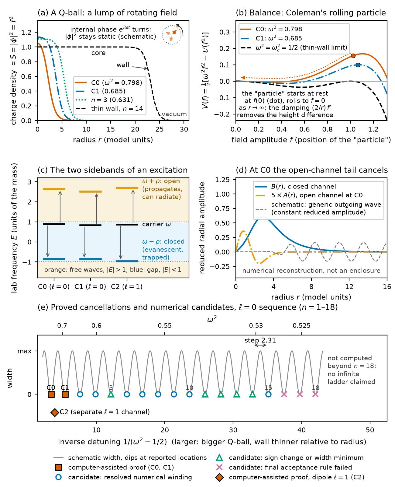

# Radiative cancellations and localized linear modes in three-dimensional sextic Q-balls

**Finn Hinrichsen — preprint version 0.52, 29 October 2026.** Not peer reviewed. Release
[`qball-bic-v0.52`](https://github.com/fmhc/physics/releases/tag/qball-bic-v0.52). This is the current version;
version 0.51 remains unchanged in [`../qball-bic-ladder-v0.51/`](../qball-bic-ladder-v0.51/README.md).

*Kurz auf Deutsch:* Preprint zu lokalisierten linearen Moden eines Q-Balls (komplexes Skalarfeld, sextisches Potential,
drei Raumdimensionen). Neu in 0.52: eine Widmung, ein allgemeinverständlicher Überblick (Abschnitt 1) und eine
Übersichtsabbildung (Abb. 1). Ergebnisse, Zahlen und Beweise sind gegenüber 0.51 unverändert. Drei Existenzaussagen sind
computergestützt mit Intervallarithmetik eingeschlossen; alles Übrige ist numerische Evidenz oder bedingte Aussage.
Nicht begutachtet, keine Messdaten. Text und Daten CC BY 4.0, Code MIT.

*Figure 1 (overview).* (a) Density profiles of stored backgrounds and the thin-wall formula; (b) Coleman's mechanical
picture; (c) the two sidebands of an excitation, one open (can radiate) and one closed; (d) at C0 the open-channel tail
cancels (stored numerical reconstruction, not a pointwise enclosure); (e) locations of the l = 0 sequence through
n = 18 and of C2 by evidence class: computer-assisted proofs for C0, C1 and C2, numerical candidates for n = 3–18. The
grey width curve and the phase inset are schematic.

## Files

| File | Content |
|---|---|
| [`paper.pdf`](paper.pdf), [`paper.html`](paper.html) | main paper (26 pages) |
| [`supplement.pdf`](supplement.pdf), [`supplement.html`](supplement.html) | supplement, 41 pages (dependency audit, exploratory driving/formation material, numerical controls, figure provenance in S7) |
| `main.tex`, `supplement.tex`, `sections/*.tex`, `*.pdf` figures, `*.png` | TeX sources and figures used by the PDF/HTML build |
| [`qball-overview.pdf`](qball-overview.pdf), [`.png`](qball-overview.png), [`.svg`](qball-overview.svg) | Figure 1 (new in 0.52) |
| [`fig-overview/`](fig-overview/README.md) | plotting script, receipt, input copies and checksums of Figure 1 |
| `style.css`, `fonts/` | HTML style and the bundled, unmodified DejaVu Math TeX Gyre font; the font keeps its own licence (`fonts/DejaVu-COPYRIGHT.txt`, `fonts/FONT-PROVENANCE.txt`) and is not covered by CC BY 4.0 |
| [`CITATION.cff`](CITATION.cff) | citation metadata |
| [`LICENSE`](LICENSE), [`LICENSE-CODE`](LICENSE-CODE) | CC BY 4.0 (text, figures, data, certificates); MIT (code) |

The companion archive (proof code, certificates, selected records) is unchanged and remains the release asset
`qball-bic-v0.51-archive-r2.zip` of release
[`qball-bic-v0.51`](https://github.com/fmhc/physics/releases/tag/qball-bic-v0.51); description and checksums in
[`../qball-bic-ladder-v0.51/archive-r2/README.md`](../qball-bic-ladder-v0.51/archive-r2/README.md).

## Changes against preprint 0.51

* **Dedication** on page 1: "Dedicated to my parents, Rommy and Helmut Hinrichsen, who taught me early on that ‘you
  cannot eat everything, but perhaps you can know everything,’ and that small daily steps of learning add up."
* **New Section 1, "A non-technical overview":** what a Q-ball is, what holds it together (Coleman's mechanical
  picture), sidebands and open/closed channels, radiation zeros as bound states in the continuum, why such zeros are
  not automatic, where they lie (with the evidence classes of the ladder table), what is not shown, and possible
  significance stated as possibilities only (no stability claim, no particle model, no experiment).
* **New Figure 1** (overview figure, five panels). It plots archived data of the 0.51 archive and evaluates formulas
  stated in the paper; no new simulation, fit or certificate run. Script, receipt and inputs are in
  [`fig-overview/`](fig-overview/README.md).
* One additional reference (Kusenko and Shaposhnikov 1998); a figure-provenance paragraph in Supplement S7 and two
  sentences in the data availability statement; wording that attributes the certificate reproduction to preprint 0.51;
  version line; a revision note.
* Section and figure numbers after the new section shift by one (old Sections 1–7 are now 2–8, old Figures 1–2 are now
  2–3). No result, number, lemma, certificate, table or earlier figure changed.

## What the paper claims, and what it does not

Unchanged from 0.51:

* **Computer-assisted existence (C0, C1, C2).** Three localized linear modes (two radial, l = 0; one dipole, l = 1) of
  the linearized two-channel equations are enclosed on the infinite radial domain: interval (ball-arithmetic) interior
  enclosures plus analytic exterior estimates. Trust assumptions: correctness of the proof code and of the ball-arithmetic
  library. For preprint 0.51 the three primary certificate runs were repeated with unchanged code; this is a
  reproduction of the same implementation, **not** an independent interval implementation.
* **Numerical sequence.** Further radial locations up to continuation index 18 are numerical candidates with the
  evidence classes listed in the paper's ladder table; they are not certified.
* **Thin-wall interpretation.** An independently computed planar transmission zero gives an unfitted spacing candidate.
  Identifying it with a radial limiting spacing remains open; an absolute-location test of the finite-order
  approximation failed and is reported.
* **Nonlinear statement (conditional).** A second-harmonic analysis separates one monopole outgoing coefficient from
  zero under explicitly audited exact-mode and enclosure hypotheses. It obstructs a specified uniformly localized smooth
  continuation for linked dipole polarizations with p·p ≠ 0; circular polarization needs a separate quadrupole
  certificate. No lifetime or stability theorem.
* No measured data are involved. The Supplement's driving, formation and response material is exploratory.

## Use of AI tools

Text, code, computations and internal reviews were produced with extensive use of Claude (Anthropic) and Codex (OpenAI)
under the author's direction; see the corresponding section of the paper.

## Licence and citation

Text, figures, data and certificates: [CC BY 4.0](LICENSE). Code (Figure 1 script here; proof code in the companion
archive): [MIT](LICENSE-CODE). Please cite: Finn Hinrichsen, *Radiative cancellations and localized linear modes in
three-dimensional sextic Q-balls*, preprint version 0.52 (2026), https://github.com/fmhc/physics/releases/tag/qball-bic-v0.52.
